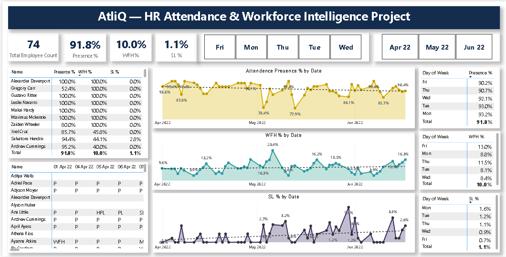

# AtliQ — HR Attendance & Workforce Intelligence Project

An end-to-end HR analytics project: raw monthly attendance sheets are turned into an interactive Power BI dashboard that shows presence, work-from-home and sick-leave patterns.



**Live dashboard:** [Click](https://app.powerbi.com/view?r=eyJrIjoiYzE1NzU0NTAtMTQ1NS00M2NkLTgxODYtZWM0ZDJhZWY1N2MwIiwidCI6ImM2ZTU0OWIzLTVmNDUtNDAzMi1hYWU5LWQ0MjQ0ZGM1YjJjNCJ9)

## Business Problem
AtliQ HR tracks attendance in manual monthly Excel sheets, so there is no quick, consistent view of presence, WFH and leave. This makes capacity planning, WFH policy decisions and early detection of attendance risk hard. Full statement: [`business-problem/problem.pdf`](business_problem/problem.pdf).

## Solution
1. Consolidated three monthly sheets (Apr–Jun 2022, about 99 employees) into one analysis-ready table.
2. Decoded attendance statuses with the attendance key (P, WFH, PL, SL, LWP, WO and half-day variants).
3. Excluded Weekly Offs so rates reflect working days only.
4. Built DAX measures for **Presence %, WFH %, SL %** and **Total Employee Count**.
5. Designed a dashboard with KPI cards, trend charts, day-of-week tables, employee drill-down and month/weekday slicers.

## Key Insights
| Metric | Value |
|---|---|
| Employees | 74 |
| Presence % | 91.8% |
| WFH % | 10.0% |
| Sick Leave % | 1.1% |

- Presence dipped in **May (89.7%)** from 91.8% in April.
- Presence falls from about 96% on Monday to **94.1% on Friday**.
- Unpaid leave (1.6%) is higher than sick leave (0.9%).
- 5 employees are logged as WFH on every recorded day in june, which affects the on-site presence KPIs.

Details and recommendations: [`report/report.md`](report/report.md).

## Repository Structure
```
├── business-problem/
│   └── problem.pdf
├── dashboard/
│   ├── dashboard.png
│   └── AtliQ — HR Attendance & Workforce Intelligence Project.pbix
├── datasets/
│   └── Attendance-Sheet-2022-2023.xlsx
├── report/
│   └── report.md
│    
└── README.md
```

## Tools
Power BI (DAX, Power Query), Excel.

## How to Use
1. Open `dashboard/AtliQ — HR Attendance & Workforce Intelligence Project.pbix` in Power BI Desktop.
2. If prompted, point the data source to `datasets/Attendance-Sheet-2022-2023.xlsx`.
3. Use the Month and Day of Week slicers to explore.

## Author
**Shantanu Dhara** · [LinkedIn](https://www.linkedin.com/in/shantanu-dhara/) · [GitHub](https://github.com/Shantanu-Dhara)
